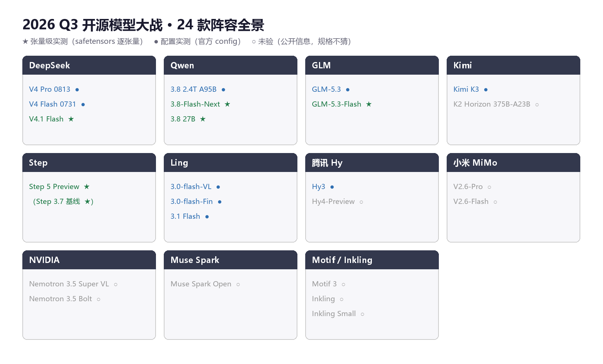
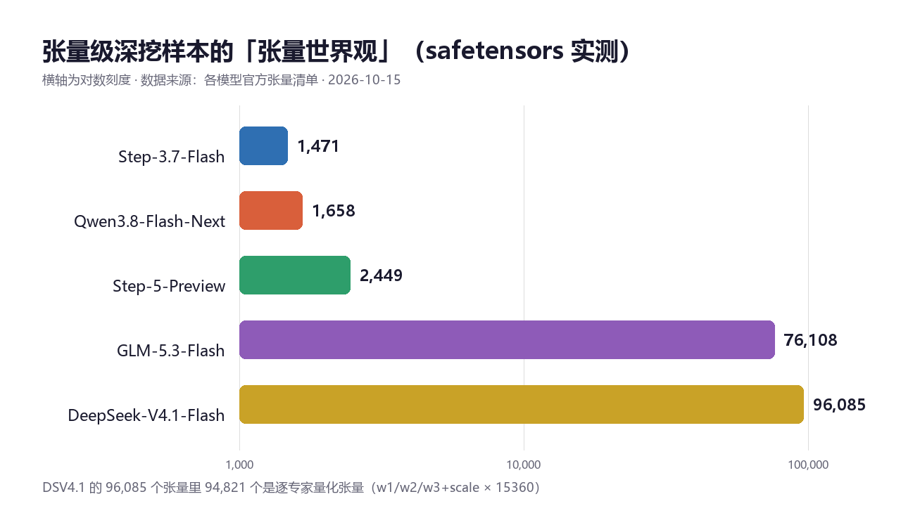
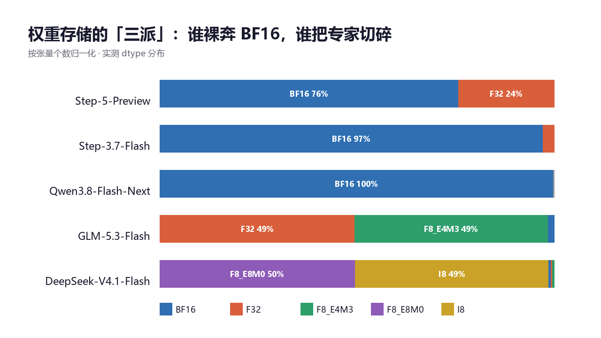
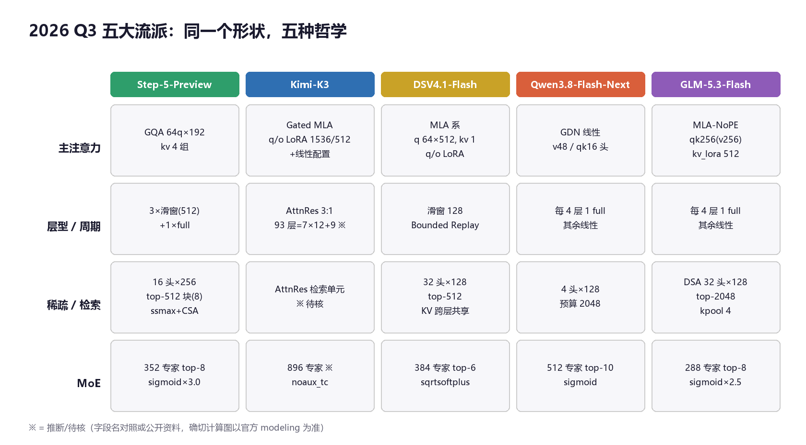
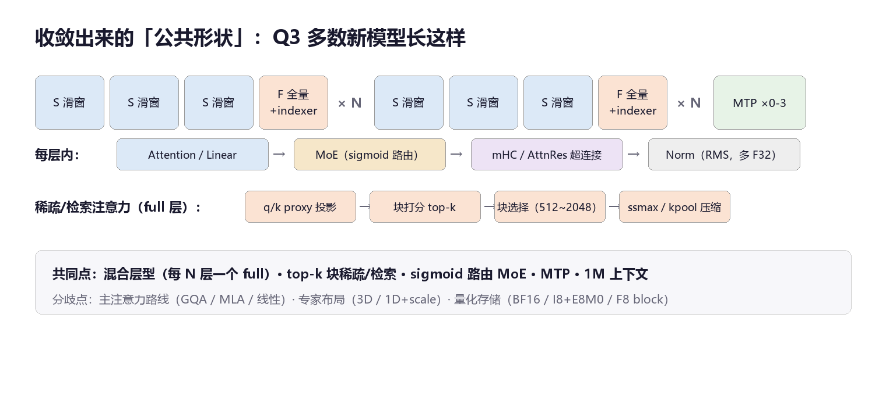

# 【2026Q3 开源模型大战】24 款模型、17.7 万个张量，一次拆到底

> 三个月，24 款开源模型。DeepSeek、Qwen、GLM、Kimi、Step、Ling、腾讯 Hy、小米 MiMo、NVIDIA……Q3 的开源战场密度前所未有。评测榜已经太多了，本文换个姿势：**不比跑分，拆张量**——所有数字来自各家官方发布的 config 与 safetensors 张量清单，17.7 万个张量逐个数过。
>
> 数据分三层，图里如实标：★ 张量级实测（逐张量 dtype/shape）· ● 配置实测（官方 config 逐字段）· ○ 未验（只有名字，**规格不猜**）。

## 一、战场全景

| 阵营 | Q3 出场 | 数据状态 |
|---|---|---|
| DeepSeek | V4 Pro 0813 · V4 Flash 0731 · V4.1 Flash | ★×1 + ●×2 |
| Qwen | 3.8 2.4T A95B · 3.8-Flash-Next · 3.8 27B | ★×2 + ●×1 |
| GLM | GLM-5.3 · GLM-5.3-Flash | ★×1 + ●×1 |
| Kimi | Kimi K3 · K2 Horizon 375B-A23B | ●×1 + ○×1 |
| Step | Step 5 Preview | ★ |
| Ling | 3.0-flash-VL · 3.0-flash-Fin · 3.1 Flash | ●×3 |
| 腾讯 Hy | Hy3 · Hy4-Preview | ●×1 + ○×1 |
| 小米 MiMo / NVIDIA / Muse Spark / Motif / Inkling | 7 款 | ○×7 |

合计：★ 张量级实测 5 款 + ● 配置实测 9 款 + ○ 未验 10 款。未验的 10 款（MiMo-V2.6 Pro/Flash、Muse Spark Open、Motif 3、K2 Horizon、Nemotron 3.5 Super VL/Bolt、Inkling×2、Hy4-Preview）在本文**只留名，不编数**。

## 二、先看一个反常识的数字：张量世界观差 65 倍

同一代模型，张量个数从 1,471（Step-3.7-Flash）到 96,085（DeepSeek-V4.1-Flash）。不是谁更复杂，是**存储世界观**不同：DSV4.1 把 384 个 MoE 专家逐个拆开存（w1/w2/w3 各带 scale），30 层 × 384 × 3 × 2 就是 94,821 个张量；Step-5 把 352 个专家打包成 3D 大张量，一步到位。

**有的团队把专家当参数存，有的团队把专家当文件存。**这个选择决定了转换器、量化器、推理引擎的整个下游生态。

## 三、存储三派：裸奔、切块、切碎

- **裸奔 BF16 派**（Step-5 / Step-3.7 / Qwen3.8-Flash-Next）：权重就是 BF16，代价是显存；
- **块量化派**（GLM-5.3-Flash）：专家权重 F8_E4M3 + 逐块 F32 scale_inv——76,108 个张量里一半是 scale，这是块量化的账单；
- **切碎派**（DSV4.1-Flash）：I8 逐专家权重 + F8_E8M0 逐块 scale，96,085 个张量的由来。

另一个被忽略的分裂：**norm 的数值通道**。Step-5 全 norm 升 F32 并要求 F32 残差，Step-3.7 还是 BF16，DSV4.1 的 eps 写到 1e-20（※ 小到反常，以官方 modeling 为准）。数值精度正在从实现细节升格为架构声明。

## 四、五大流派：同一个形状，五种哲学

1. **Step-5-Preview**：保守骨架（GQA 64 头×192）+ 激进稀疏（full 层挂 16 头 indexer，top-512 块、ssmax+CSA 压缩）；
2. **Kimi-K3**：Gated MLA（q/o LoRA 1536/512）+ **AttnRes 深度维注意力**——93 层 = 7×12+9 的块划分（※ 按公开资料与 config 层数对照），896 专家的 MoE 是全场最大，且不带 MTP；
3. **DeepSeek-V4.1-Flash**：MLA 系压到 kv 1 头 + 32 头 indexer，独门绝技是 **KV 跨层共享**（source 层 [2,8,14,20]）；同门的 V4 Pro/Flash（0813/0731）延续同路线（index 64 头，top-512/1024）；
4. **Qwen3.8-Flash-Next**：最激进，主线是 **GDN 线性注意力**，每 4 层才 1 个 full 层，indexer 只给 4 个头；
5. **GLM-5.3-Flash**：**NoPE-MLA**（主注意力零 RoPE，位置全交给 indexer 的 rope），稀疏预算最大（top-2048）；旗舰 GLM-5.3 同路线放大（78 层、q_lora 2048）。

**mHC / AttnRes 超连接**成了 Q3 的暗线：DSV4.1、GLM-5.3、Qwen3.8-Flash-Next、Kimi-K3 全上了跨层混合，Step-5 是深挖样本里唯一没上的。一年前还在论文里的东西，现在是 config 字段。

## 五、收敛出的公共形状

共同点（Q3 多数新模型）：混合层型（每 N 层一个 full）· top-k 块稀疏/检索 · sigmoid 路由 MoE · MTP · 1M 级上下文。

分歧点（每家自己的答案）：主注意力路线（GQA / Gated MLA / 线性）· 专家布局（3D / 逐专家 1D）· 量化存储（BF16 / I8+E8M0 / F8 block）· 位置编码（逐层数组 / YaRN / mrope / NoPE）。

Ling 3.0/3.1 系列是另一个值得盯的样本：512 专家 top-8 的大 MoE + kv_lora 512，金融（Fin）和视觉（VL）变体共享同一文本骨架——**一个骨架多个分身**是 Q3 的另一种打法。

## 六、写给转换器和推理引擎作者的三组坑

1. **专家布局三派互不兼容**：3D 打包 [E,out,in]、逐专家 1D+scale、gate_up/down 打包——转置错一个维度，输出完全跑偏但不报错；
2. **量化 scale 语义各不相同**：F8_E8M0 逐 32 值一块（DSV4.1）vs F32 scale_inv 逐 128×128 块（GLM）——都叫 scale，算式不一样；
3. **逐层数组 vs 显式层表**：Step 家 rope_theta 是 95 项数组（含 MTP 3 层，按层数截断就丢数据），DS/GLM 是显式层号列表——两种元数据模型，现有 GGUF 都表达不全。

## 七、数据纪律、缺口与复算

- 本文所有数字来自各家官方 config 与 safetensors 张量清单；★ 层为逐张量实测（dtype/shape 全量），● 层为 config 逐字段，推断处标 ※；
- **10 款未验模型只留名**：MiMo-V2.6 系、Muse Spark Open、Motif 3、K2 Horizon、Nemotron 3.5 Super VL/Bolt、Inkling 系、Hy4-Preview——配置未公开或仓库名未定位，规格一个都不猜；
- 复现方式与出处审计随仓库发布。**发现任何数字对不上，请开 issue——能被推翻的数字才有价值。**

（署名与作者说明：待定。本文由作者与 AI 协作完成，全部数据由作者实测核验，作者对内容负全责。）

---

*数据截止：2026-10-15。Step 5 Preview 为 preview 版本，字段可能变动。*
